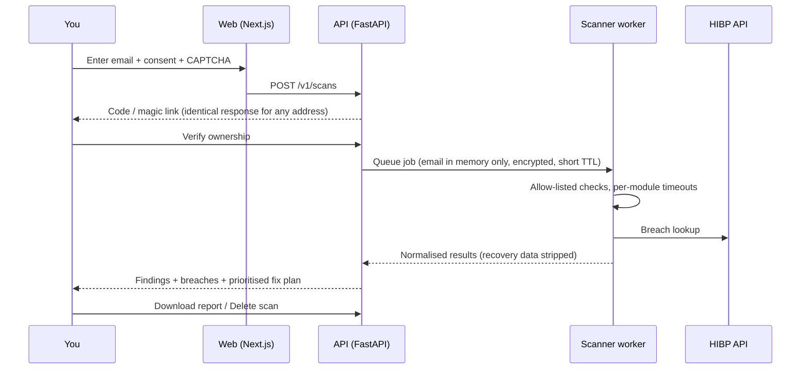

<div align="center">

# FootprintX

### Know your footprint. Clean it up.

**Audit your own digital footprint: verify your email, see the accounts and data breaches tied to it, and get step-by-step cleanup guides.**
Open-source · privacy-first · results deleted within 24 hours.

[](https://github.com/im-anishraj/footprintx/actions)
[](LICENSE)
[](services/scanner/LICENSE)
[](https://github.com/im-anishraj/footprintx/stargazers)
[](CONTRIBUTING.md)


[Live demo](#) · [Quick start](#-quick-start) · [How it works](#-how-it-works) · [Privacy model](#-privacy-and-safety-by-design) · [Contributing](#-contributing)

<!-- Replace with a <15s GIF: verify → scan → fix. This is the single biggest driver of stars. -->


</div>

---

## Why this exists

Most people have no idea how many services hold an account tied to their email, which of those leaked in a breach, or how to close the ones they no longer use. Existing tools tend to fall into two camps:

- **Investigator tools** that let anyone look up any email address.
- **Exposure alerts** that tell you _that_ you're exposed, not _what to do next_.

FootprintX does one thing: **you prove an email is yours, and it gives you an honest report plus a prioritised plan to fix it.**

## ✨ What you get

- **Owner-verified scans only.** No scan, no breach lookup and no result before you verify the email (code or magic link).
- **Account discovery** via a curated, non-sensitive allow-list of services. Results are labelled as _indicators_, never proof.
- **Breach exposure** via the [Have I Been Pwned](https://haveibeenpwned.com) API: breach name, date and data classes.
- **Fix guides for every finding:** step-by-step account deletion and hardening guides (2FA, password manager, email aliases, Google third-party app review, photo metadata, data-broker opt-outs).
- **Prioritised action plan:** Today / This week / This month.
- **Honest coverage line:** e.g. "26 of 28 checks completed". No fake scores, no fake progress bars.
- **Export** a PDF or Markdown report (generated on demand, never stored) and **delete your scan** at any time.
- **Self-hostable**, no trackers, no ads.

## 🔍 How it works



**Result statuses:** `indicator_found` · `likely` · `not_detected` · `unknown` · `rate_limited` · `unable_to_verify` · `skipped`.
**Confidence:** `high` (two independent signals) · `medium` (one healthy check) · `low` (degraded or ambiguous).

## 🛡️ Privacy and safety by design

| Guarantee                              | How                                                                                          |
| -------------------------------------- | -------------------------------------------------------------------------------------------- |
| You can only scan an email you control | Ownership verification is required before anything runs; no production bypass                |
| Can't be used to probe other people    | Identical API responses for any address, per-address and per-IP rate limits, CAPTCHA         |
| Your email isn't stored                | Only an HMAC of the normalised address is kept for abuse counters (30 days)                  |
| Results are short-lived                | Encrypted (AES-256-GCM, envelope keys), deleted after 24 hours or on request                 |
| No leaked recovery data                | Recovery emails/phones and extra fields are stripped at the adapter; tests enforce it        |
| No sensitive lookups                   | Adult, dating, health-related and financial services are excluded by default                 |
| Logs stay clean                        | Emails, OTPs, tokens and results are never logged; a test fails if an email reaches the logs |
| Honest language                        | "May be associated", never "your account is active"                                          |

**FootprintX deliberately does not have:** an "enter any email" mode, phone lookups, a public API, user accounts, a single "risk score", or "dark web" claims. See [`docs/SECURITY.md`](docs/SECURITY.md) and [`docs/METHODOLOGY.md`](docs/METHODOLOGY.md).

## 🆚 How it differs

|                        | Account discovery  | Breach check | Fix steps                | Any-email lookup             | Cost                  |
| ---------------------- | ------------------ | ------------ | ------------------------ | ---------------------------- | --------------------- |
| **FootprintX**         | Curated allow-list | Yes (HIBP)   | **Yes, per finding**     | **No (owner-verified only)** | Free, self-hostable   |
| Holehe (CLI)           | Yes, 100+ modules  | No           | No                       | Yes                          | Free                  |
| Have I Been Pwned      | No                 | Yes          | General advice           | Yes (breach only)            | Free search; paid API |
| OSINT lookup platforms | Yes                | Some         | No                       | Yes                          | Mostly paid           |
| Data-removal services  | No                 | Some         | Automated broker removal | n/a                          | Paid subscription     |

FootprintX is complementary: it doesn't remove you from data brokers; it helps you clean up the accounts you created yourself.

## 🚀 Quick start

Requirements: Docker and Docker Compose.

```bash
git clone https://github.com/im-anishraj/footprintx.git
cd footprintx
cp .env.example .env
./scripts/generate-secrets.sh   # fills SERVER_PEPPER, MASTER_KEY, SESSION_SECRET
make dev                        # or: docker compose up --build
```

Open:

| Service                  | URL (default)              |
| ------------------------ | -------------------------- |
| Web app                  | http://localhost:3000      |
| API docs                 | http://localhost:8000/docs |
| Mail catcher (OTP codes) | http://localhost:8025      |

By default the scanner runs in **mock mode**: deterministic demo data, **no requests to real third-party sites**, clearly labelled in the UI. Verification still works: grab the code from the mail catcher.

### Live mode

```bash
# .env
SCANNER_MODE=live
HIBP_API_KEY=...            # https://haveibeenpwned.com/API/Key
TURNSTILE_SITE_KEY=...      # Cloudflare Turnstile
TURNSTILE_SECRET_KEY=...
EMAIL_PROVIDER=resend       # or smtp
RESEND_API_KEY=...
```

Read the [methodology](docs/METHODOLOGY.md) and the terms of the services you query before running live mode in production. Automated checks against third-party sites may be restricted by their terms.

### Configuration

| Variable                                       | Purpose                                                        |
| ---------------------------------------------- | -------------------------------------------------------------- |
| `APP_ENV`                                      | `development` or `production`                                  |
| `DATABASE_URL`, `REDIS_URL`                    | PostgreSQL and Redis                                           |
| `SERVER_PEPPER`                                | HMAC key for abuse counters                                    |
| `MASTER_KEY`                                   | Wraps per-scan encryption keys (supports key IDs for rotation) |
| `SESSION_SECRET`                               | Session signing                                                |
| `SCANNER_MODE`                                 | `mock` (default) or `live`                                     |
| `HIBP_API_KEY`                                 | Breach lookups (optional; degrades gracefully)                 |
| `TURNSTILE_*`                                  | CAPTCHA keys (test keys in dev/CI)                             |
| `EMAIL_PROVIDER`, `RESEND_API_KEY` / SMTP vars | OTP and magic-link delivery                                    |
| `WEB_ORIGIN`                                   | Allowed web origin for CORS/CSRF                               |
| `SENTRY_DSN`                                   | Optional error tracking (PII scrubbed)                         |
| `CANARY_CONFIG`                                | Operator-owned test accounts for module health checks          |

Full reference: [`docs/SETUP.md`](docs/SETUP.md) (includes deployment, SPF/DKIM/DMARC, backups and a launch checklist).

## 🧱 Architecture

```
footprintx/
├── apps/web/            Next.js (App Router) + TypeScript + Tailwind
├── apps/api/            FastAPI, SQLAlchemy, Alembic, RQ
├── services/scanner/    Isolated worker + adapter around Holehe (GPL-3.0)
├── content/guides/      YAML fix guides, one per service (SEO pages)
├── content/services.yaml  Service catalog and module allow-list
└── docs/                SECURITY, METHODOLOGY, ARCHITECTURE, SETUP
```

| Layer           | Tech                                                      |
| --------------- | --------------------------------------------------------- |
| Web             | Next.js, TypeScript (strict), Tailwind CSS                |
| API             | Python 3.12, FastAPI, Pydantic v2, PostgreSQL, Redis + RQ |
| Scanner         | Separate container with no database credentials           |
| Email / CAPTCHA | Resend or SMTP, Cloudflare Turnstile                      |
| Reports         | WeasyPrint (PDF) and Markdown                             |
| Tests           | pytest, Vitest, Playwright + axe, ruff, mypy, eslint      |

Deep dive: [`docs/ARCHITECTURE.md`](docs/ARCHITECTURE.md).

## 🩺 Scanner reliability (module health)

Site-specific checks break when sites change their forms. FootprintX treats that as a first-class problem:

- A **nightly canary** runs every enabled module against test accounts the operator owns (`make canary`).
- If a module's result flips, it is marked **degraded** and hidden from user results until it passes again.
- `/v1/modules` and the [methodology page](docs/METHODOLOGY.md) show live module health.
- "Not detected" always means _not detected by this method_, never "no account exists".

## 🔌 API (v1)

| Endpoint                                   | Purpose                                                            |
| ------------------------------------------ | ------------------------------------------------------------------ |
| `POST /v1/scans`                           | Create a scan and send a code (identical response for any address) |
| `POST /v1/scans/{id}/verify`               | Verify ownership and queue the scan                                |
| `GET /v1/scans/{id}`                       | Status and progress                                                |
| `GET /v1/scans/{id}/results`               | Findings, breaches, actions, coverage                              |
| `GET /v1/scans/{id}/report?format=pdf\|md` | Report export                                                      |
| `DELETE /v1/scans/{id}`                    | Hard-delete everything now                                         |
| `GET /v1/modules`                          | Public module list and health                                      |

Interactive docs at `/docs` when the API is running.

## 🗺️ Roadmap

- [ ] **v0.1 MVP:** verify → scan → results → fix guides → export → delete; mock and live modes
- [ ] **v0.2:** more vetted modules, more fix guides, Hindi and other translations
- [ ] **v0.3:** local-only scan comparison over time, guided account-deletion wizards, email-alias recommendations
- [ ] **Later:** user-guided Google third-party app review, optional self-host templates for campuses and clubs

Track progress in [Issues](https://github.com/im-anishraj/footprintx/issues) and [Projects](https://github.com/im-anishraj/footprintx/projects).

## 🤝 Contributing

Contributions are very welcome, especially the non-code kind:

| Good first contributions                                               | Where               |
| ---------------------------------------------------------------------- | ------------------- |
| Write or verify a **fix guide** (delete/secure a service)              | `content/guides/`   |
| Add a **vetted module** (non-sensitive, with tests and a canary entry) | `services/scanner/` |
| **Translate** UI and guides                                            | `apps/web/`         |
| Improve **accessibility** (WCAG 2.2 AA)                                | `apps/web/`         |
| Find and report **security or privacy issues**                         | see below           |

```bash
make dev        # run everything locally in mock mode
make test       # unit, API, privacy and scanner tests
make e2e        # Playwright end-to-end + axe accessibility
make lint       # ruff, mypy, eslint
make canary     # module health check (needs CANARY_CONFIG)
```

Please read [`CONTRIBUTING.md`](CONTRIBUTING.md) and [`CODE_OF_CONDUCT.md`](CODE_OF_CONDUCT.md). Look for issues labelled `good first issue` and `help wanted`.

**Contribution rules that protect users:** no changes that weaken verification, add any-email lookup, log personal data, or enable sensitive-category modules by default. PRs that do will be declined.

## 🔐 Security

Found a vulnerability? **Please don't open a public issue.** Report it privately via [GitHub Security Advisories](https://github.com/im-anishraj/footprintx/security/advisories/new) or the contact in [`SECURITY.md`](SECURITY.md).

## ⚖️ Responsible use

FootprintX is for auditing **your own** accounts. Do not use it, or a fork of it, to look up other people's email addresses. The verification step exists for exactly this reason; removing or bypassing it in a deployment is outside the intended use of this project. Results are indicators only and may contain false positives and false negatives. This is not legal, security or identity-theft-protection advice.

## 📄 License and credits

- **Application** (`apps/`, `content/`, `docs/`): [MIT](LICENSE)
- **Scanner** (`services/scanner/`): [GPL-3.0](services/scanner/LICENSE), because it incorporates [Holehe](https://github.com/megadose/holehe) (GPL-3.0). Running it as a hosted service doesn't by itself trigger source-distribution duties, but **distributing** it does; keep notices intact.
- Breach data: [Have I Been Pwned](https://haveibeenpwned.com) (Troy Hunt). Attribution is shown in the app; please follow HIBP's current terms.
- Full third-party list: [`NOTICE.md`](NOTICE.md).

## ❓ FAQ

**Can I scan someone else's email?** No. You must receive and enter a code sent to the address.

**Do you store my email?** No raw email is persisted. An HMAC is kept for rate limits (30 days). Results are encrypted and deleted within 24 hours or when you delete them.

**Is "not detected" proof I have no account?** No. It means this method didn't detect one.

**Why isn't there a risk score?** Scores from partial data mislead. FootprintX shows counts, coverage and a prioritised plan instead.

**Can I self-host?** Yes. See [`docs/SETUP.md`](docs/SETUP.md).

**Does it remove my data from data brokers?** No. It helps you close accounts you created and fix what leaked. Use a dedicated removal service for brokers.

---

<div align="center">

If FootprintX helped you clean up, **a ⭐ helps others find it.**

[](https://star-history.com/#im-anishraj/footprintx&Date)

</div>
